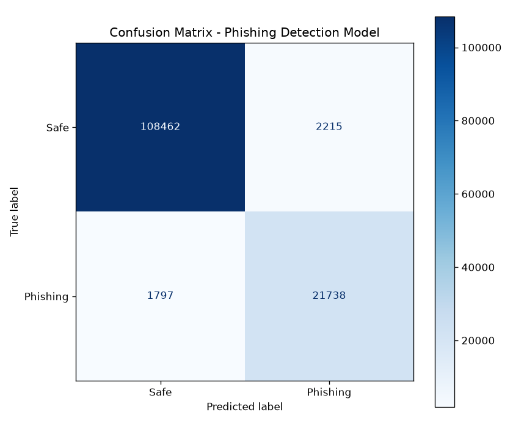

# AI Phishing Detector

A phishing-website detector that combines a machine-learning URL classifier, live HTML inspection and visual brand-impersonation detection, delivered through a Flask API and a Chrome extension (Manifest V3).

## How it works

Every scan blends three independent signals into one verdict:

| Signal | Weight | What it does |
|---|---|---|
| **URL model** | 50% | Random Forest trained on 38 URL features (length, character counts, entropy, suspicious TLDs, brand/keyword placement, hex tokens, embedded domains) |
| **HTML analysis** | 30% | Fetches the page and checks for external form actions, hidden iframes, obfuscated JS, password fields over HTTP, external favicons, disabled right-click |
| **Visual check** | 20% | Screenshots the page with headless Chrome and compares its perceptual hash against 8 major brands; flags a match hosted on the wrong domain |

Final score: **≥ 60 → Phishing**, **≥ 35 → Suspicious**, otherwise **Safe**. A conservative path-impersonation heuristic (brand in path + phishing-kit keywords + embedded domain) and a whitelist of major domains sit on top of the model.

## Results

Evaluated on a held-out 20% split (134,212 URLs):

| Accuracy | Precision | Recall | F1 |
|---|---|---|---|
| 97.01% | 90.75% | 92.36% | 91.55% |

On 100 completely unseen URLs (50 legitimate from Tranco ranks 30k–60k, 50 live phishing from PhishTank), adding legitimate Tranco data and the path heuristic raised accuracy from **47% → 99%** and cut false positives from **50 → 0**.



## Chrome extension

- **Auto-scan** badges every tab (red `!`, amber `?`, green `✓`) using the fast URL-only mode
- **In-page warning banner** on high-risk pages, with a "Leave this site" button
- **Popup** for full scans of the current tab or a pasted URL, with a score gauge and per-signal breakdown
- **Reports page** with scan history, CSV export, and formal threat reports for flagged sites

## Project structure

```
app.py              Flask API + live model dashboard
model/              Feature extraction, analyzers, training & evaluation scripts
extension/          Chrome extension (MV3)
data/eda_charts/    EDA and evaluation charts
tests/              pytest suite
test_samples/       Synthetic phishing pages for testing the HTML analyzer
```

## Setup

```bash
pip install -r requirements.txt
```

### Datasets and model

The datasets and trained model are not in this repo (the model is ~230 MB). To rebuild:

1. Download [Malicious URLs dataset](https://www.kaggle.com/datasets/sid321axn/malicious-urls-dataset) → `data/malicious_phish.csv`
2. Download the [Tranco top sites list](https://tranco-list.eu/) → `data/tranco_top.csv`
3. Run the pipeline from inside `model/`:

```bash
cd model
python preprocess.py
python add_legit_data.py
python train.py
```

### Run

```bash
python app.py          # API on http://127.0.0.1:5000
```

Then load the extension: `chrome://extensions` → enable Developer mode → **Load unpacked** → select the `extension/` folder.

Model dashboard: http://127.0.0.1:5000/dashboard

### Tests

```bash
pytest
```

## Tech stack

Python, scikit-learn, Flask, BeautifulSoup, Selenium, imagehash, JavaScript (Chrome Extension MV3)
